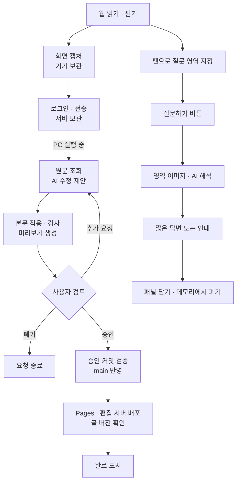
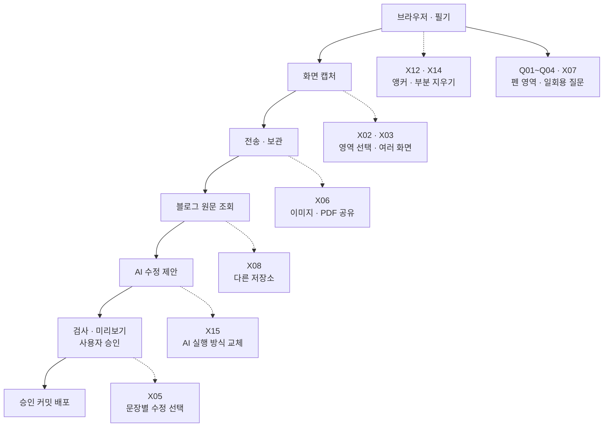

# SketchBrowser 기능 구현 현황과 확장 지도

기준일: 2026-10-28. 필기 비트맵 직접 합성과 **전체화면 접이식 펜 도구함·하단 화면 전환·작은 이동식 답변 카드**를 포함한 **0.2.5(versionCode 11)** APK를 빌드하고 다운로드 검증했다. 소스는 `2cf98c7`이며 CI 타입·단위 33개·Android 입력 7개·네이티브 빌드·APK v2 서명 검사를 통과했다. 실물 Galaxy Tab의 업데이트 설치·캡처·카드 조작 확인은 남아 있다.
이 문서는 다음 작업을 고르고 구현 범위를 확인하는 기준표다. 기능 ID를 유지하면서 행을 추가하고, 구현 상태와 검증 결과는 따로 갱신한다.

사용자 요청 “빌드하고 링크줘”에 따라 수동 워크플로를 실행했다. [0.2.5 APK 다운로드](https://github.com/imjae/SketchBrowser/actions/runs/40656212037/artifacts/12802102884)의 ZIP에 `SketchBrowser-0.2.5-test.apk`가 있으며 이전 앱과 같은 서명으로 업데이트할 수 있다.

**앱 빌드는 사용자가 요청할 때만 실행한다.** 2026-10-28 사용자가 질문 기능을 포함한 APK와 다운로드 링크를 명시적으로 요청했다. 이전 0.2.1·0.2.2 검증 기록은 아래에 유지한다.

## 상태 읽는 방법

| 표시 | 의미 |
| --- | --- |
| 구현 | 실제 실행 경로에 연결된 코드가 있음. 실물 사용까지 모두 확인했다는 뜻은 아님 |
| 일부 구현 | 기능의 일부만 제공하며 표에 적힌 제한이 있음 |
| 작업 중 | 구현을 시작했지만 완료 조건을 충족하지 못함 |
| 검증 대기 | 코드 추가보다 실제 기기·사용자 흐름 확인이 남음 |
| 미구현 후보 | 확장 아이디어. 아직 착수하거나 제공하는 기능이 아님 |
| 설정 변경 | 작업 규칙·CI 설정 변경. 원격 반영 여부를 별도로 표시 |

## 전체 사용 흐름

PC가 꺼져 있으면 새 수정안 생성과 main 반영이 대기한다. 서버에 접수한 요청, 이미 만든 미리보기, 승인은 유지된다. 그림은 구현된 흐름을 뜻하며, 사용자가 실제 글을 승인하는 전체 실사용 검증은 아직 남아 있다.

영역 질문은 보호된 Worker를 거쳐 개인 PC의 별도 질문 실행기를 원격 사용한다. API 키 없이 Codex의 ChatGPT 구독 로그인을 사용하고 PC가 꺼져 있으면 즉시 연결 안내를 표시한다. 질문 기록과 오프라인 대기열은 없다. 상세 범위는 [영역 질문](quick-question.md)을 따른다.

## 기능 구현 표

### 브라우저와 필기

| ID | 기능 | 구현 상태 | 현재 범위·제한 | 확인한 범위 | 관련 코드 |
| --- | --- | --- | --- | --- | --- |
| B01 | 주소·검색·앞뒤 이동·새로고침 | 구현 | 외부 웹 탐색은 Android WebView. 웹 데모는 연습 페이지 중심 | 브라우저 자동 검사 | [App.tsx](../App.tsx), [BrowserSurface.tsx](../src/browser/BrowserSurface.tsx), [urls.ts](../src/urls.ts) |
| B02 | 도구 접기·전체화면·화면 크기 대응 | 구현 | 화면 전환 버튼은 페이지 밖 하단. 전체화면의 하단 펜 도구함에서 질문·필기 도구 선택. 펼침·접힘 시 페이지 크기 유지. APK 0.2.5 포함 | 가로·세로·390px 도구함과 View/Edit 모사 버튼 클릭, 질문 선택 유지, 전체화면 왕복 시 문서·필기·실행 취소 유지 검사 | [App.tsx](../App.tsx) |
| N01 | 펜·밑줄·형광펜·지우개 | 구현 | 색·굵기·압력 지원. 지우개는 획 전체 삭제 | 브라우저·네이티브 입력 자동 검사 | [engine.ts](../src/ink/engine.ts), [model.ts](../src/model.ts) |
| N02 | S Pen 버튼 임시 지우기 | 구현 | 버튼을 누르는 동안 지우개 유지, 놓으면 이전 도구 복귀. 호버만으로는 지우지 않음 | 이전 APK에서 사용자 실물 확인 + 입력 자동 검사. 0.2.2 실물 재확인은 별개 | [SketchStylusInput.kt](../plugins/android/SketchStylusInput.kt), [engine.ts](../src/ink/engine.ts) |
| N03 | 펜만 입력·두 손가락 탐색 전환 | 구현 | 같은 방향 드래그로 탐색 전환. 모든 기기의 손바닥 차단을 보장하는 기능은 아님 | 브라우저·입력 패킷 자동 검사 | [engine.ts](../src/ink/engine.ts) |
| N04 | 실행 취소·다시 실행 | 구현 | 획과 당시 원문 해시를 함께 복원 | 기존 획 복원 자동 검사, 해시 복원 코드 확인 | [engine.ts](../src/ink/engine.ts) |
| N05 | URL별 저장·복원·서재 | 구현 | 기기 로컬 저장, 저장 실패 재시도. 기기 간 동기화 없음 | 저장소 단위·브라우저 자동 검사 | [notebook.ts](../src/storage/notebook.ts), [useNotebook.ts](../src/useNotebook.ts) |
| N06 | 스크롤·문단 이동에 따른 필기 위치 보정 | 일부 구현 | DOM 문단 앵커·좌표 사용. 글자 단위 앵커, PDF·복잡한 iframe은 미지원 | 앵커 위치 자동 검사. 모든 외부 사이트 보장 아님 | [engine.ts](../src/ink/engine.ts), [model.ts](../src/model.ts) |

### 일회용 영역 질문

| ID | 기능 | 구현 상태 | 현재 범위·제한 | 확인한 범위 | 관련 코드 |
| --- | --- | --- | --- | --- | --- |
| Q01 | 펜으로 질문 영역 지정 | 구현 | APK 0.2.3부터 질문 영역 도구에서 한 바퀴 둘러싸기. 선택선은 필기·실행 취소·저장에 포함하지 않음. 화면 이동·변경 시 다시 선택 | DOM·네이티브 펜 패킷, 열린 선·터치 제외, 스크롤·회전·본문 변경 자동 검사·APK 코드 포함 확인 | [engine.ts](../src/ask/engine.ts), [App.tsx](../App.tsx) |
| Q02 | 선택 영역 이미지 | 구현 | 원문 전용 캡처에 별도 복사한 필기 비트맵을 직접 합성하고 자유형 경계 밖을 흰색 처리. 선택선·버튼 제외. PNG base64 최대 4MB. 합성 보완은 APK 0.2.5 포함 | 원문 캡처에 필기가 없는 조건의 Chrome 픽셀·형광펜 1회 합성·배율·엄격한 이미지 CSP·취소 시 복원 검사. 실물 WebView 캡처 대기 | [engine.ts](../src/ask/engine.ts), [capture.ts](../src/ask/capture.ts), [BrowserSurface.tsx](../src/browser/BrowserSurface.tsx) |
| Q03 | 짧은 답변·내용 없음 안내 | 구현 | GitHub 소유자 한 명, 개인 PC Codex의 ChatGPT 구독과 임시 이미지 질문. 손글씨 질문 우선, 본문은 참고 문맥. 질문이 없으면 내용 설명, 내용 없음·판독 불가는 고정 안내. PC 실행기 갱신 완료 | 인증·CSRF·실제 Cloudflare 런타임 중계·취소·답변 UI 자동 검사. 실제 구독 호출에서 인쇄된 1+1만 있을 때 2, 펜 획 7+5=?를 함께 합성하면 12 확인. 실물 한글 손글씨 품질은 미확인 | 블로그 [sketch-question.mjs](../../imjae.github.io/server/sketch-question.mjs), [codex-question.mjs](../runner/codex-question.mjs) |
| Q04 | 저장하지 않는 답변 카드 | 구현 | 본문 조작을 막지 않는 폭 최대 440px 카드. 선택 영역과 겹침이 적은 모서리에 배치, 제목 드래그·접기·확대. 접기는 같은 WebView 유지, 닫기·페이지 이동은 폐기. APK 0.2.5 포함 | 본문 크기 유지·배경 클릭/스크롤·이동·접기/확대·회전/390px·Escape 우선 닫기 검사. 실제 WebView 로그인·S Pen 카드 조작은 검증 대기 | [QuestionShell.tsx](../src/ask/QuestionShell.tsx), [QuestionPanel.tsx](../src/ask/QuestionPanel.tsx), [useQuestion.ts](../src/ask/useQuestion.ts) |

### 필기 전송과 요청 관리

| ID | 기능 | 구현 상태 | 현재 범위·제한 | 확인한 범위 | 관련 코드 |
| --- | --- | --- | --- | --- | --- |
| R01 | 원문+필기 화면 캡처 | 구현 | 현재 화면 한 장의 PNG와 보이는 획·텍스트·원문 해시. 캡처 중 화면 변화 검사 | 캡처 문맥 자동 검사. 태블릿의 실제 PNG 캡처는 검증 대기 | [BrowserSurface.tsx](../src/browser/BrowserSurface.tsx), [transfer.ts](../src/review/transfer.ts), [engine.ts](../src/ink/engine.ts) |
| R02 | 이전 필기와 현재 원문 버전 확인 | 구현 | 버전이 없거나 다른 옛 필기는 위치·문장 확인 후 전송. 최신 main 원문이 다르면 새 캡처 요구 | 입력·버전·재연결 자동 검사 | [transfer.ts](../src/review/transfer.ts), 블로그 [sketch-protocol.mjs](../../imjae.github.io/server/sketch-protocol.mjs) |
| R03 | 미전송 요청 보관·재전송 | 구현 | 기기에 한 개 보관, 설명도 제출 전 저장. 같은 ID 재전송 지원. 여러 요청의 오프라인 대기열은 없음 | UI 저장 확인 응답·서버 중복 접수 검사. 기기 강제 종료 복구는 검증 대기 | [ReviewPanel.tsx](../src/review/ReviewPanel.tsx), 블로그 [sketch-review.mjs](../../imjae.github.io/server/sketch-review.mjs) |
| R04 | GitHub 소유자 로그인 | 구현 | 기존 소유자 한 명만 접근. 일반 사용자 가입·계정별 저장소 설정 없음 | 인증 자동 검사·운영 서버 비로그인 차단 확인. 새 APK 로그인은 검증 대기 | [ReviewPanel.tsx](../src/review/ReviewPanel.tsx), 블로그 [author-auth.mjs](../../imjae.github.io/server/author-auth.mjs) |
| R05 | 요청 보관·작업 임대·진행 상태 | 구현 | SQLite Durable Object, 실행기 한 작업씩 처리, 만료된 임대 회수 | 서버 상태 자동 검사·실행기 연결 확인 | 블로그 [sketch-review.mjs](../../imjae.github.io/server/sketch-review.mjs), [main.mjs](../runner/main.mjs) |
| R06 | 추가 요청·폐기·자료 삭제 | 구현 | 허용된 상태에서만 재수정·폐기·삭제. 재수정은 이전 승인 무효화. 배포 중 폐기는 불가 | 서버 상태·검토 UI 자동 검사 | 블로그 [sketch-ui.mjs](../../imjae.github.io/server/sketch-ui.mjs), [sketch-review.mjs](../../imjae.github.io/server/sketch-review.mjs) |

### AI 수정·검토·배포

| ID | 기능 | 구현 상태 | 현재 범위·제한 | 확인한 범위 | 관련 코드 |
| --- | --- | --- | --- | --- | --- |
| A01 | 대상 주소에서 실제 원본 찾기 | 구현 | 공개 Markdown 글 또는 크래프톤 포트폴리오의 합성 문구. 소유자 편집 주소는 공개 대상으로 정규화 | 원본 조회 단위 검사·실제 글/포트폴리오 조회. APK 0.2.2부터 두 대상 지원 | 블로그 [sketch-target.mjs](../../imjae.github.io/scripts/sketch-target.mjs) |
| A02 | 이미지·문맥을 이용한 AI 수정안 | 구현 | PC Codex CLI가 문장 교체 JSON 또는 질문 반환. AI에게 파일 수정·배포 도구를 제공하지 않음 | 실제 이미지 입력 AI 호출·수정안 생성. 다양한 실제 손글씨 해석은 추가 확인 필요 | [core.mjs](../runner/core.mjs), [main.mjs](../runner/main.mjs) |
| A03 | 대상 문구만 적용·변경 범위 검사 | 구현 | 글은 본문 문자열 교체. 포트폴리오는 기존 키·원문이 일치하는 600자 이하 문구를 새 JSON 한 개로 저장. 메타데이터·다른 파일·HTML·새 외부 URL 거절 | 교체 범위 단위 검사·격리 작업 공간에서 실제 AI 글/포트폴리오 수정 | [core.mjs](../runner/core.mjs), [main.mjs](../runner/main.mjs), 블로그 [sketch-portfolio.server.mjs](../../imjae.github.io/src/lib/sketch-portfolio.server.mjs) |
| A04 | 블로그 빌드·사이트·화면 검사 | 구현 | 전체 사이트 검사, 보호된 편집 빌드, 수정 글·Home·긴 글·모바일 검색 검사 | 실제 AI 수정안에 검사 수행 | [main.mjs](../runner/main.mjs), [preview.mjs](../runner/preview.mjs) |
| V01 | 변경 비교·글 미리보기 | 구현 | 실제 빌드의 정적 HTML. CSS·렌더된 도표 포함, 영상·스크립트·페이지 이동 제외 | 실제 수정 미리보기의 데스크톱·모바일 표시 및 sandbox 자동 검사 | [preview.mjs](../runner/preview.mjs), 블로그 [sketch-ui.mjs](../../imjae.github.io/server/sketch-ui.mjs) |
| V02 | 사용자 승인 | 구현 | 확인 체크박스 후 승인. 해당 세대·커밋·미리보기·diff에 묶임. 24시간 유효 | 무승인·오래된 승인 거절 및 UI 자동 검사. 실제 글에 대한 사용자 승인은 아직 없음 | 블로그 [sketch-review.mjs](../../imjae.github.io/server/sketch-review.mjs), [sketch-ui.mjs](../../imjae.github.io/server/sketch-ui.mjs) |
| D01 | 승인한 커밋만 main 반영 | 구현 | 커밋·원문·diff·미리보기 재확인 후 일반 push. 경쟁 변경 시 중단 | 승인·경쟁 변경 상태 검사. 실제 글 승인 후 push는 실사용 검증 대기 | [main.mjs](../runner/main.mjs) |
| D02 | 두 서버 배포·실제 글 확인 | 구현 | 동일 커밋의 Pages·편집 서버 Actions 및 양쪽 원문 해시 확인 후 완료 | 기반 서버 배포·실제 버전 대조 확인. 사용자 글의 승인 배포 전체 경로는 검증 대기 | [main.mjs](../runner/main.mjs), 블로그 [deploy.yml](../../imjae.github.io/.github/workflows/deploy.yml), [authoring.yml](../../imjae.github.io/.github/workflows/authoring.yml) |

### 운영과 앱 빌드

| ID | 기능 | 구현 상태 | 현재 범위·제한 | 확인한 범위 | 관련 코드 |
| --- | --- | --- | --- | --- | --- |
| O01 | PC 실행기 시작·중지·연결 복구 | 구현 | 숨겨진 프로세스, DPAPI 자격 증명, 개인 작업 폴더. 재부팅 후 수동 시작 | 실제 시작·중지·재연결 확인 | [setup.mjs](../runner/setup.mjs), [launch.mjs](../runner/launch.mjs), [start.ps1](../runner/start.ps1) |
| O02 | 요청 용량·보관 기간 제한 | 구현 | 요청 100개, 이미지 base64 4MB, 설명 4,000자. 완료·폐기·실패 자료 30일 정리. PC 자료 자동 정리는 없음 | 용량·분할 파일 해시 검사. 30일 운영 경과 확인은 아님 | 블로그 [sketch-protocol.mjs](../../imjae.github.io/server/sketch-protocol.mjs), [sketch-review.mjs](../../imjae.github.io/server/sketch-review.mjs) |
| O03 | 요청할 때만 앱 빌드 | 설정 변경 | 프로젝트 규칙에 명시. 현재 작업 브랜치와 원격 main의 APK 워크플로는 수동 실행만 사용 | 작업 브랜치와 main `fcf57b4` 반영. 0.2.1·0.2.2·0.2.3은 각각 사용자 요청에 따른 workflow_dispatch 실행 | [AGENTS.md](../AGENTS.md), [android-apk.yml](../.github/workflows/android-apk.yml) |

## UI/UX 구현 현황과 개선 기준

읽기·필기 화면은 서재, 주소창, 도구막대, 저장 상태를 갖춘 형태다. AI 검토 화면은 변경 비교·글 미리보기·보낸 필기 탭과 하단 승인 영역으로 구성한다. 아래의 **현재 UI**는 구현된 내용이며, **다음 개선·완료 기준**은 남은 작업이다. 브라우저 검사와 실제 태블릿의 사용성 확인은 구분한다.

| ID | 화면·사용 경험 | 현재 UI | 다음 개선·완료 기준 | 관련 위치 |
| --- | --- | --- | --- | --- |
| U01 | 읽기·필기 | 크림색·초록색 중심. 넓은 화면은 왼쪽 서재, 좁은 화면은 서랍. 일반 화면의 상단 도구 접기, 전체화면의 하단 도구함, 페이지 밖 화면 전환, 작은 답변 카드 제공 | 가로·세로·390px 웹 검사 완료. Galaxy Tab의 S Pen 도구함·카드 이동·로그인 조작 검증은 남음 | B02, Q04, N01~N05, [App.tsx](../App.tsx) |
| U02 | 수정 요청 진입 | 일부 구현: 글·크래프톤 포트폴리오 지원. 대상 밖 화면·로딩·복원 이유 표시, 눌렀을 때 안내, 공개 글 목록 이동 제공 | 타입·단위 23개 검사 통과. APK 0.2.2에 포함. 미전송·검토 대기 배지는 남음 | R01~R03, [App.tsx](../App.tsx), [availability.ts](../src/review/availability.ts) |
| U03 | 캡처 확인·전송 | 전체화면 검토 창에서 소유자 로그인 후 캡처 이미지·설명 입력·전송 취소 제공 | 처음 로그인하는 흐름에서도 캡처가 보관됐음을 안내. 대상 글·보내는 화면을 확인하고 전송 완료를 분명히 알 수 있도록 정리 | R01~R04, [ReviewPanel.tsx](../src/review/ReviewPanel.tsx), 블로그 [sketch-ui.mjs](../../imjae.github.io/server/sketch-ui.mjs) |
| U04 | 요청 목록·진행 상태 | 상태와 제목을 버튼 목록으로 표시. PC 연결 여부·작업 상태를 8초마다 갱신. 선택한 상세가 같은 페이지에 표시됨 | `접수 → 수정·검사 → 검토 대기 → 배포 → 완료` 단계 표시. PC 대기와 오류를 구분하고, 사용자가 지금 해야 할 행동을 함께 안내 | R05, O01, 블로그 [sketch-ui.mjs](../../imjae.github.io/server/sketch-ui.mjs) |
| U05 | 변경 내용·미리보기 | 구현: 변경 비교·글 미리보기·보낸 필기 탭. 900px 이상은 수정 전후 나란히, 좁은 화면은 전환. 변경 위치 선택·이전/다음 제공. 원본 diff는 접힌 상세. 미리보기는 독립 스크롤 영역 | 브라우저의 가로·세로·좁은 화면 검사 통과. 실제 Galaxy Tab에서 회전·펜 조작 확인은 남음. Markdown 문법은 평문으로 보존하며 렌더된 글은 미리보기에서 확인 | V01, 블로그 [sketch-ui-client.mjs](../../imjae.github.io/server/sketch-ui-client.mjs), [sketch-diff.mjs](../../imjae.github.io/server/sketch-diff.mjs) |
| U06 | 추가 수정·승인 | 구현: 하단에 확인 체크·승인·추가 수정 버튼 유지. 추가 요청은 별도 입력 화면, 승인 대상 버전 검증 유지. 상태 조회만으로 입력·스크롤·체크가 초기화되지 않음 | 브라우저에서 긴 비교·화면 축소·입력 보존·명시적 승인 검사 통과. 새 수정안은 확인 상태를 초기화. 문장별 선택은 별도 X05 범위 | R06, V02, 블로그 [sketch-ui-client.mjs](../../imjae.github.io/server/sketch-ui-client.mjs) |
| U07 | 오류·복구 | 앱 오류 막대, 검토 창 오류 문구, 서버의 실패·재캡처 상태 표시. 앱의 캡처 오류도 공통 `다시 시도` 경로에서 페이지를 새로고침함 | 캡처 실패는 재캡처, 로그인 실패는 로그인, PC 연결 대기는 대기 안내처럼 원인별 다음 행동 연결. 전송·재시도 후 중복 요청이나 필기 손실이 없어야 함. 배포 복구 기능은 X11과 연결 | R03~R06, X11, [App.tsx](../App.tsx), [ReviewPanel.tsx](../src/review/ReviewPanel.tsx) |
| U08 | 배포 완료·읽기 복귀 | `공개 글 열기` 제공. 앱의 검토 WebView에서 공개 블로그 링크는 외부 브라우저로 열림 | 앱 안의 해당 글로 돌아가 최신 글을 확인하는 동선 검토. 기존 필기의 원문 버전·위치가 달라졌다면 사용자에게 표시 | D02, N06, [ReviewPanel.tsx](../src/review/ReviewPanel.tsx) |
| U09 | 시각적 일관성·버전 표시 | 일부 구현: 검토 화면은 크림색·초록색과 공통 CSS 변수 사용. 앱 하단 버전은 app.json에서 표시 | 읽기 화면과 검토 화면 사이의 완전한 디자인 토큰 공유는 남음 | [App.tsx](../App.tsx), 블로그 [sketch-ui-style.mjs](../../imjae.github.io/server/sketch-ui-style.mjs) |
| U10 | 태블릿·접근성 | 일부 구현: 검토 버튼 최소 높이 48px, 비교 본문 17px. 탭 키보드 조작·포커스 표시·작은 높이 대응. 앱 검토 창은 SafeAreaView와 48px 헤더 버튼 사용 | 1280×800, 800×1280, 1024×600, 390×844 브라우저 배치 검사. 실제 기기의 글자 확대·키보드·회전·시스템 영역 확인은 남음. 읽기 화면의 작은 보조 글자는 별도 개선 대상 | X01, [ReviewPanel.tsx](../src/review/ReviewPanel.tsx), 블로그 [sketch-ui-style.mjs](../../imjae.github.io/server/sketch-ui-style.mjs) |

### 권장 화면 구성과 작업 순서

1순위 검토 화면 개선은 구현했다. 요청 목록은 넓은 화면에서 왼쪽, 좁은 화면에서 목록 버튼으로 연다. 2·3순위 전송·진행·복구 기능의 추가 개선은 남아 있다.

| 순서 | 개선 작업 | 사용자가 바로 알 수 있어야 할 것 |
| --- | --- | --- |
| 1 · 구현 | U05~U06 검토 화면: 수정 전후 비교·글 미리보기·추가 요청·승인 동작 정리 | 어디가 어떻게 바뀌었고, 어떤 수정안을 승인하는지 |
| 2 | U02~U04 전송·요청 화면: 캡처 확인·접수 결과·단계별 상태 정리 | 무엇을 보냈고, 지금 어느 단계이며, 내 확인이 필요한지 |
| 3 | U07~U08 복구·완료 화면: 상황별 다음 행동과 글 복귀 연결 | 문제가 생겼을 때 무엇을 하면 되고, 배포된 글을 어디서 확인하는지 |
| 병행 | U01·U09·U10 공통 UI와 실물 확인 | 읽기·필기·검토 화면이 일관되고 태블릿에서 편하게 조작되는지 |

검토 UI는 실제 서버 처리 코드와 메모리 테스트 요청으로 브라우저 검사했다. Worker 배포용 번들에서도 같은 검사를 수행했다. 예제 수정안만 사용했으며 실제 공개 글을 승인·게시한 검사는 아니다. 실제 Galaxy Tab의 새 로그인·필기 전송·승인 사용성 확인은 남아 있다.

### 0.2.1 실사용 진입 문제 점검

사용자가 `/portfolio/krafton-2027/?edit=1`에서 전송 버튼의 무반응을 보고했다. 현재 지원 대상은 공개 `/writing/<slug>/` 본문이므로 포트폴리오는 전송되지 않는다. `?edit=1` 자체는 공개 글의 전송을 막지 않는다. 기존 UI는 이유를 표시하지 않은 채 클릭만 비활성화했다.

최초 진단 뒤 대상·로딩 상태 안내를 추가했다. 이어 사용자 요청으로 아래 포트폴리오 지원을 구현했다. 당시 0.2.1은 공개 글 전용이었다. 2026-10-27 별도 빌드 요청에 따라 확장을 포함한 0.2.2 APK를 만들었다.

### 포트폴리오 필기 수정 확장

| ID | 기능 | 구현 상태 | 범위·확인 결과 | 관련 코드 |
| --- | --- | --- | --- | --- |
| P01 | 공개·편집 주소의 포트폴리오 캡처 | 구현 | `/portfolio/krafton-2027/`와 고정 소유자 origin 지원. 쿼리·fragment 정규화, 표시 문구 문맥·합성 원문 해시 사용. APK 0.2.2 포함 | [contract.ts](../src/review/contract.ts), [engine.ts](../src/ink/engine.ts), 블로그 [sketch-target.mjs](../../imjae.github.io/server/sketch-target.mjs) |
| P02 | 미저장 직접 편집 감지 | 구현 | 미저장 문구가 있으면 캡처 거절. 캡처 중 직접 편집이 생겨도 일관성 검사 실패. 브라우저 검사 통과 | [engine.ts](../src/ink/engine.ts), 블로그 [portfolio-copy-editor.ts](../../imjae.github.io/src/scripts/portfolio-copy-editor.ts) |
| P03 | 문구 키 기반 AI 수정·비교 | 구현 | 기존 키·원문 확인 후 새 JSON 한 개만 추가. 기본 문구·기존 기록·영상·순서 보존. 실제 AI 한 문구 시험 수정·전체 사이트 검사·미리보기 생성 통과. 문구별 전후 비교 제공 | 블로그 [sketch-portfolio.server.mjs](../../imjae.github.io/src/lib/sketch-portfolio.server.mjs), [main.mjs](../runner/main.mjs) |
| P04 | 포트폴리오 승인·배포 버전 확인 | 구현 | 기존 승인·경쟁 main 검사에 파일/합성 문구 해시와 양쪽 배포 확인 연결. 메모리 요청 승인, 실제 격리 결과 검증·변조/무승인 거절 통과. 실제 소유자 승인 배포는 검증 대기 | [main.mjs](../runner/main.mjs), 블로그 [sketch-review.mjs](../../imjae.github.io/server/sketch-review.mjs) |

2026-10-25 확장 구현 당시 앱 타입·단위 23개, 블로그 전체 검사 114개·Astro 오류 0개·128개 HTML 검사, 보호된 빌드, 실제 Worker 번들의 글/포트폴리오 검토 E2E를 통과했다. 실제 AI 시험 커밋은 격리 작업 공간의 `9abb016`이며 공개하지 않았다. 기본 문구와 공개 포트폴리오는 그대로다. 서버 `38bf66d`의 Pages·편집 Worker 배포 성공과 공개/편집 원문 해시 일치를 확인하고 PC 실행기를 새 코드로 재시작했다. 당시 새 APK 빌드·실물 태블릿 확인은 수행하지 않았다. 후속 0.2.2 APK 빌드는 아래 기록을 따른다.

## 확장할 때 바꿀 위치

실선은 현재 연결, 점선은 남은 확장 범위다. 공통 요청 처리기·모델 어댑터·저장소 어댑터가 이미 추상화되어 있다는 뜻은 아니다. 현재 코드에는 전용 블로그 주소·원본 경로·서버가 고정되어 있다.

| ID | 상태 | 확장할 기능 | 연결되는 기존 기능 | 시작할 위치 | 완료 확인 기준 |
| --- | --- | --- | --- | --- | --- |
| X01 | 검증 대기 | Galaxy Tab에서 전체 흐름 확인 | R01~R04, V02, D01~D02 | 현재 앱·검토 화면 | 실물 캡처·로그인·재시도 후 사용자가 실제 수정안을 승인하고 두 서버 반영 확인. 앱 빌드는 별도 요청 때만 |
| X02 | 일부 구현 | 캡처 영역 선택 | R01, Q01~Q02 | `src/ask/`·`BrowserSurface` | 일회용 질문의 자유형 영역 구현·자동 검사 완료. 블로그 수정 요청은 기존 전체 화면 사용. 실물 확대·회전 검증 대기 |
| X03 | 미구현 후보 | 여러 화면을 한 요청에 첨부 | R01~R03, A02 | `Transfer`·서버 입력 규격·`askCodex` | 같은 글의 캡처를 순서대로 보관·미리보기하고 이미지와 수정 위치의 연결 유지 |
| X04 | 미구현 후보 | 여러 미전송 요청·오프라인 재시도 | R03, R05 | `ReviewPanel` 보관 파일 구조 | 여러 요청이 앱 재시작 후 남고 개별 재전송 시 중복 접수 없음 |
| X05 | 미구현 후보 | 문장별 수정 선택 | A03, V01~V02 | 교체 JSON·변경 비교 UI·승인 규격 | 선택한 변경만 적용하고 새 커밋·미리보기로 재검사·재승인 |
| X06 | 미구현 후보 | 필기 이미지·PDF 내보내기 | N05, R01 | 캡처·기기 파일·Android 공유 | 원문 주소·필기가 포함된 파일을 AI 계정 연결 없이 저장·공유 |
| X07 | 구현 | 일반 페이지에서 일회용 AI 질문·설명 | Q01~Q04 | `src/ask/`·블로그 `server/sketch-question.mjs`·`runner/question.mjs` | 소유자 로그인·PC Codex 구독 연결과 APK 0.2.3 포함 확인. 실제 합성 이미지 응답 확인, 기기 검증은 남음 |
| X08 | 미구현 후보 | 다른 블로그·저장소·페이지 유형 | A01, D01~D02 | 고정 URL·원본 조회·검사·배포 경로 분리 | 대상마다 원본 조회·허용 파일·검사·미리보기·승인 배포 규칙을 명시하고 오적용 차단 |
| X09 | 미구현 후보 | PC 실행기 자동 시작 | O01 | 실행기 수명 관리 | 사용자가 켜고 끌 수 있고, 재부팅 후 중복 프로세스 없이 연결 복구 |
| X10 | 미구현 후보 | 수정 완료·배포 실패 알림 | R05, D02 | 서버 상태·앱 알림 | 사용자가 알림을 켜고 끌 수 있으며, 해당 요청의 실제 상태와 일치하는 알림을 한 번 전달 |
| X11 | 미구현 후보 | 실패한 배포 복구 UI | D01~D02 | 검토 UI·실행기·Actions 확인 | 재시도는 승인한 버전을 유지하고, 앞선 main을 덮어쓰지 않음 |
| X12 | 미구현 후보 | 글자 단위 필기 위치 보정 | N06 | 저장 모델·앵커 알고리즘 | 문단 편집·화면 회전 뒤 위치를 확인하고, 모호한 연결은 표시 |
| X13 | 미구현 후보 | 필기 백업·복원 | N05 | 저장소·서재 UI | 원본 파일에서 획·주소·버전을 복원하고 다른 URL의 필기와 섞이지 않음 |
| X14 | 미구현 후보 | 획 부분 지우개 | N01, N04 | 필기 엔진·획 저장 모델 | 닿은 구간만 지워지고 실행 취소 시 원래 획·압력·앵커 복원 |
| X15 | 미구현 후보 | AI 실행 방식 교체 | A02~A03 | `askCodex`와 교체 제안 계약의 분리 | 선택한 실행 방식이 동일한 결과 규격을 반환하고, 변경 범위 검사·사용자 승인 규칙을 유지 |

## 2026-10-28 질문 사용성 APK 0.2.5 검증

- 사용자 빌드 요청 뒤 소스 `2cf98c7b96c67957c9fd0c59d65db1e5082462a9`의 [수동 빌드](https://github.com/imjae/SketchBrowser/actions/runs/40656212037)가 성공했다. [APK 다운로드](https://github.com/imjae/SketchBrowser/actions/runs/40656212037/artifacts/12802102884)는 2026-11-27까지 보관하며 ZIP에서 `SketchBrowser-0.2.5-test.apk`를 설치한다.
- CI 타입·단위 33개와 Android 입력 7개가 통과했다. 실제 본문·답변 WebView 입력 구분, 도구창 위 입력 차단과 바깥 본문 입력, 기존 Samsung 버튼/취소/호버 경로를 포함한다. 첫 시도에서 발견한 Robolectric 설정의 지원하지 않는 인자와 가상 디스플레이 밖 테스트 좌표를 보정했다.
- 패키지는 `com.sketchbrowser.app`, 버전 `0.2.5`, versionCode `11`, ARM64·ARMv7이다. 네이티브 빌드와 APK v2 서명 검사가 통과했고 이전 0.2.4 인증서와 일치한다.
- 실제 내려받은 APK는 40,591,798 bytes, SHA-256 `743287e418e1e905cea903653ceb0f2e88f7f24af35eb994666b29da23ce7f22`다. 소스·버전·크기·해시를 빌드 기록과 대조했으며 ZIP SHA-256 `a9f4ba8b07c6c0a164a06377f6bd4012ae43954b9d54eb635f228e004fc37791`도 GitHub artifact digest와 일치한다.
- Hermes 번들에서 필기 합성·답변 카드·접기/확대·전체화면 도구함 코드를, DEX에서 본문 전용 펜 입력 표식을 확인했다. 검증본은 `dist/apk/0.2.5/`에 있다. PC 질문 실행기는 실행 중이며 연결 완료 기록을 확인했다.
- 이번 빌드에서 Worker·공개 글을 변경하거나 배포하지 않았다. 자동 검사와 APK 검증은 실제 Galaxy Tab 업데이트 설치·원문/필기 합성·GitHub 로그인·카드 조작 검증과 구분한다.

## 2026-10-28 전체화면 질문과 답변 카드 사용성

- 일반 화면의 전체화면 진입과 전체화면 종료 버튼을 모두 페이지 밖 하단 줄로 옮겼다. 페이지 오른쪽 위에 떠 있는 앱 버튼을 제거해 View/Edit 영역과 겹치지 않는다. 안전 영역을 유지하며 페이지 너비는 도구함·카드 열기에 따라 바뀌지 않는다.
- 전체화면 하단의 **펜 도구함**으로 탐색·펜·밑줄·형광펜·지우개·질문 영역을 선택하고 색·굵기·실행 취소도 사용할 수 있다. 도구 선택 시 접히며, 도구함을 단순히 열고 닫아도 본문 크기·선택 영역·필기는 유지한다.
- 답변은 어두운 배경이나 입력 차단 없는 작은 카드로 표시한다. 기본 높이는 보통 본문의 약 36%, 최대 320px이며 최소 읽기 높이와 남은 공간에 맞춘다. 선택 영역과 겹침이 적은 모서리를 고르고 제목을 끌어 옮길 수 있다. 접기·확대·닫기를 구분하고, 접을 때 WebView를 제거하거나 재전송하지 않는다.
- 질문 이미지 준비 뒤 탐색 모드로 돌아가 원문을 바로 읽고 스크롤할 수 있다. 뒤로 가기/Escape는 답변 → 열린 도구함 → 전체화면 순서로 처리한다. 회전으로 서재가 서랍으로 바뀔 때 열린 답변을 가리지 않게 접는다. 카드의 드래그 중에는 임시 입력 면으로 iframe/WebView에 포인터가 넘어가지 않게 한다.
- Android 펜 가로채기는 `sketch-ink-surface` 표시가 있는 본문 WebView에만 적용한다. 같은 화면에 있는 답변·GitHub 로그인 WebView의 일반 펜 클릭·스크롤을 가로채지 않도록 경계를 추가했고 네이티브 회귀 테스트를 작성했다.
- `pnpm typecheck`, 단위 33개, `pnpm test:e2e`, `pnpm test:question`, `pnpm test:review`가 통과했다. 1280×900·800×1100·390×844에서 카드 배치·이동·접기·확대·본문 클릭/스크롤·회전을 검사하고 전체화면 질문 선택과 View/Edit 모사 버튼 클릭을 확인했다. 검증 이미지는 `test-results/question/`에 있다.
- `android/gradlew.bat -p tests/android testDebugUnitTest`는 `JAVA_HOME` 미설정·`java` 실행 파일 부재로 시작하지 못했다. 브라우저의 Android 입력 패킷 검사를 실제 Android 테스트·Galaxy Tab 조작 확인으로 확대하지 않는다. APK 빌드·서버 배포·블로그 변경은 수행하지 않았다.

## 2026-10-28 영역 질문의 필기 포함 보완

- 서버는 블로그 원문 텍스트를 별도로 조회하지 않고 잘라낸 PNG 한 장만 전달한다. 기존 앱은 Android 네이티브 캡처에 필기 캔버스까지 찍힌다고 가정했고, AI 지시에도 손글씨 질문과 인쇄된 본문의 우선순위가 없었다. 실제 사용자 기기의 전송 이미지는 저장하지 않으므로 이번 조사에서 필기 누락과 모델 해석 중 어느 쪽인지 확정하지 않았다.
- 선택선을 제외한 필기 캔버스를 메모리 비트맵으로 복사하고, 원문을 캡처하는 동안 표시 캔버스의 불투명도를 0으로 바꾼다. WebView의 두 프레임 뒤 준비를 알리고 원문 PNG에 필기 비트맵을 직접 합성한다. 형광펜 중복 합성을 막으며 취소·실패·타임아웃 시 불투명도를 복원하고 임시 비트맵을 해제한다. 기존 필기 저장 규칙은 유지한다.
- AI는 손글씨 질문을 먼저 읽고 인쇄된 본문을 문맥으로 사용한다. 손글씨 질문을 읽을 수 없으면 본문 요약으로 대신하지 않고 판독 불가 안내를 요청한다. 밑줄·동그라미만 있는 경우에는 기존 설명 흐름을 유지한다.
- 타입 검사·단위 31개, 질문 캡처/중계/번들 브리지와 기존 글/포트폴리오 검토 E2E가 통과했다. 원문 캡처에 필기 픽셀이 없는 상태에서도 합성 결과에 펜 획이 있고, 형광펜은 한 번만 섞이며, 준비 응답 전 취소와 캡처 실패 뒤 표시가 복원되는 것을 검사했다.
- 실제 Android 입력 패킷 경로로 그린 합성 수식 `7+5=?`와 인쇄된 `1+1은?`를 사용했다. 실제 `gpt-6.1-sol`/`low` 호출에서 인쇄된 원문만 있을 때 `1 + 1은 2입니다.`, 필기 합성본에는 `7 + 5 = 12입니다.`를 받았다. 합성 PNG를 시각 확인했으며 실제 S Pen 한글 판독률이나 태블릿 캡처 재현 결과는 아니다.
- PC 질문 실행기를 재시작하고 운영 Worker 연결 완료를 확인했다. Worker 코드·공개 글은 변경하거나 배포하지 않았다. 앱 빌드를 요청받지 않아 APK는 생성하지 않았으며, 현재 0.2.4에는 새 필기 합성 코드가 없다.

## 2026-10-28 질문 이미지 전달 대기 오류 수정

- Wrangler가 `questionClient.toString()`에 서버 전용 `__name` 호출을 넣어 브라우저가 초기화 중 멈췄다. 실제 Worker dry-run 번들을 Chrome에서 실행해 `__name is not defined`, 수신 함수 미정의와 대기 문구를 재현했다. 질문 클라이언트를 기존 검토 UI와 같은 원본 문자열로 보존해 해결했다.
- Android WebMessageListener는 `event.nativeEvent.url`에 전체 경로 대신 source origin을 전달한다. 정확한 `/sketch/ask/`만 받던 앱이 준비 메시지를 버렸다. 허용 서버의 origin 또는 정확한 질문 URL을 수신하며, 이미지 주입 시 현재 페이지 origin·경로를 다시 검사한다. 인증 페이지·다른 도메인으로 이미지를 전달하지 않는다.
- 페이지 로딩 완료에도 전달을 시도하고 수신 ID 확인 응답을 받는다. 같은 ID는 답변 요청을 다시 만들지 않는다. 8초 안에 수신 확인이 없으면 재연결 안내를 표시하며 확인 후에는 새로고침으로 재전송하지 않는다.
- 앱 타입·단위 31개, 서버 123개, 질문 캡처·중계·브리지 및 기존 글/포트폴리오 E2E가 통과했다. 브리지 검사는 Wrangler와 같은 keepNames 번들 및 실제 Wrangler dry-run 번들로 Android origin-only·기존 전체 URL·준비 메시지 유실·중복 전달을 검사한다. 이전 검사가 원본 서버 모듈만 실행해 놓친 배포 형태를 포함했다.
- 소스 수정·검사 후 사용자가 “0.2.4 APK 빌드하고 링크 제공”을 명시적으로 선택했다. 0.2.4(versionCode 10)으로 수동 빌드하며 실물 기기 확인은 별도다.
- 서버 `ab61af0853041b3e941307e1784173b8658b3fc1`의 [보호 서버 배포](https://github.com/imjae/imjae.github.io/actions/runs/40648401177)와 [Pages](https://github.com/imjae/imjae.github.io/actions/runs/40648401067)가 성공했다. 보호 서버의 테스트·타입·편집 빌드가 통과했고 PC 질문 실행기가 다시 연결됐다. 별도 작업 중인 Study 본문·목록 변경은 이 커밋에 포함하지 않았다.
- 앱 소스 `3958ef29e51f344252a1c33f808ab8da06150c09`의 [0.2.4 수동 빌드](https://github.com/imjae/SketchBrowser/actions/runs/40648481454)가 성공했다. [APK 다운로드](https://github.com/imjae/SketchBrowser/actions/runs/40648481454/artifacts/12799355944)의 ZIP에서 `SketchBrowser-0.2.4-test.apk`를 설치한다. 보관 기한은 2026-11-27이다.
- CI 타입·단위 31개, Android/Samsung 입력 검사, APK v2 서명 검사를 통과했다. 패키지 `com.sketchbrowser.app`, 버전 `0.2.4`, versionCode `10`, ARM64·ARMv7이다. 받은 APK는 40,582,694 bytes이며 SHA-256 `2d8ecc28c0fc182887e6d5390ca3782426f632e3de444c0aa25f19dc5ff06ae0`이 빌드 기록과 일치한다. ZIP 해시도 artifact digest와 대조했다.
- APK의 Hermes 번들에서 질문 수신 확인 메시지와 전달 실패 안내를 확인했다. v2 서명 인증서가 0.2.3과 동일해 업데이트 설치를 지원한다. 검증본은 `dist/apk/0.2.4/`에 있다. 자동 검사·패키지 확인을 실물 Galaxy Tab에서 답변 표시까지 확인한 결과로 확대하지 않는다.

## 2026-10-28 질문 기능 포함 APK 0.2.3

- 사용자가 질문 기능을 포함한 앱 빌드와 APK 다운로드 링크를 명시적으로 요청했다. 소스 `be36fe8e44032fe6d60ad79e9f6391719a5c692b`의 [수동 빌드](https://github.com/imjae/SketchBrowser/actions/runs/40644592233)가 성공했다. [GitHub APK 다운로드](https://github.com/imjae/SketchBrowser/actions/runs/40644592233/artifacts/12797013042)의 ZIP에 `SketchBrowser-0.2.3-test.apk`가 있으며 2026-11-27까지 보관한다.
- 버전 `0.2.3`, versionCode `9`, 패키지 `com.sketchbrowser.app`, ARM64·ARMv7 설치형 APK다. CI 타입·단위 30개, Android/Samsung 입력 검사, APK v2 서명 검사가 통과했다.
- 실제 받은 APK는 40,581,150 bytes이며 SHA-256 `f52b0a309308947d52aeaf688b9ac9559b58dae4708e83b46af6bc856ecb7c30`이 산출물 기록과 일치한다. ZIP 해시도 GitHub artifact digest와 일치한다. 로컬 검증본은 `dist/apk/0.2.3/`에 있다.
- APK 안의 Hermes 번들에서 질문 도구·영역 캡처·자유형 마스크·보호 답변 페이지·전송/종료 코드를 확인했다. v2 서명 인증서 SHA-256 `fac61745dc0903786fb9ede62a962b399f7348f0bb6f899b8332667591033b9c`가 이전 0.2.2와 같아 업데이트 설치를 지원한다.
- 서버와 PC 질문 실행기는 앞서 연결을 확인했다. Galaxy Tab에서 실제 업데이트 설치·GitHub 로그인·S Pen 영역 캡처·운영 서버 답변 전체 흐름을 실행한 결과는 아니다. 질문에는 PC가 켜져 있고 `question:start` 실행기가 연결되어 있어야 한다.

## 2026-10-28 구독 연결과 서버 배포

- 사용자 요청에 따라 API 키 연결을 개인 PC Codex의 ChatGPT 구독 연결로 변경했다. ChatGPT 인증 정보는 PC 밖으로 보내지 않는다. `questionModel=gpt-6.1-sol`, 추론 `low`, 임시 이미지 질문과 도구 차단을 사용한다.
- 앱 타입·단위 30개, 질문 캡처·답변 UI·실제 Miniflare WebSocket 중계와 글/포트폴리오 검토 E2E가 통과했다. 서버 전체 122개·Astro 오류/경고 0개·공개/편집용 사이트 131경로·137 HTML 검사가 통과했다.
- 실제 구독 호출에서 합성 “1 + 1은?” 이미지에 “1 + 1 = 2입니다.”(약 4.7초), 흰색 400×300 이미지에 `no_content`(약 5.4초)를 받았다. 이는 고정 합성 예시의 관찰값이며 손글씨 정확도·보장 응답 시간은 아니다.
- 서버 커밋 `b293287a0573a7998dafdbca5ca3b5b49b408afe`의 [보호 서버 배포](https://github.com/imjae/imjae.github.io/actions/runs/40643453131)와 [Pages](https://github.com/imjae/imjae.github.io/actions/runs/40643453170)가 성공했다. 공개 글 본문은 변경하지 않았다.
- 운영 서버에서 비로그인 API 401·HTML 로그인 이동, 실행기 인증 연결 성공과 중복 연결 409를 확인했다. PC 질문 실행기의 시작·중지·재시작을 확인하고 연결된 상태로 두었다. 앱의 질문 이미지·답변, PC 질문 런타임 폴더에는 질문 파일을 저장하지 않는다.
- 앱 빌드는 수행하지 않았다. 기존 APK 0.2.2에 질문 도구는 없으며 새로운 앱의 GitHub 로그인→영역 캡처→운영 서버 답변 전체 흐름과 S Pen 손글씨는 실물 검증이 남는다. PC 재부팅 후 `pnpm question:start`로 다시 켜야 한다.

## 2026-10-28 일회용 영역 질문 최초 구현 검증

- 앱 타입 검사·단위 28개, 기존 필기·상호작용·S Pen·네이티브 입력과 질문 패널의 브라우저 검사, 별도 영역 이미지·답변 UI 검사, 글·포트폴리오 검토 검사를 수행했다.
- 블로그 서버 전체 단위 121개를 통과했다. 한 Git 픽스처에서 PC 전역 Git 설정 파일 접근 오류가 발생해, 검사 프로세스에만 `GIT_CONFIG_GLOBAL=NUL`을 지정하여 전체 검사를 다시 통과했다. 전역 설정 파일은 수정하지 않았다.
- 가로·세로·390px 패널 배치와 실제 Chrome 캡처의 선택 영역·마스크 픽셀을 확인했다. AI 결과는 테스트 대역을 사용했으므로 실제 한글 손글씨 판독이나 답변 품질을 확인한 결과는 아니다.
- 앱 빌드·서버 배포·API 자격 증명 등록·실제 AI 호출·실물 Galaxy Tab 검증은 수행하지 않았다. 운영 연결에는 [영역 질문 설정](quick-question.md)이 필요하다.

## 2026-10-27 포트폴리오 지원 APK 0.2.2

- 사용자 요청에 따라 [수동 빌드](https://github.com/imjae/SketchBrowser/actions/runs/40466825257)를 실행해 성공했다. [GitHub APK 다운로드](https://github.com/imjae/SketchBrowser/actions/runs/40466825257/artifacts/12717092802)의 ZIP에 `SketchBrowser-0.2.2-test.apk`가 있다.
- 소스 `732c0f847d6bfb77d3f8adb41ff2da672f4f1d84`, versionCode `8`, 패키지 `com.sketchbrowser.app`. 이전 0.2.1과 같은 서명 인증서를 확인해 업데이트 설치할 수 있다.
- 타입·단위 23개, 글/포트폴리오 검토 E2E, CI Android·Samsung 입력 검사·APK v2 서명 검사가 통과했다. 타입 검사에서 이전 시험 작업 공간을 읽지 않도록 `test-results` 등 생성 폴더를 제외했다.
- 받은 APK 40,551,594 bytes의 SHA-256은 `b8fe9cb51994dcfde4a433e5896defeca14971fa518fdc4c74026414e6b16f0c`이며 빌드 기록과 일치한다. ARM64·ARMv7 라이브러리와 내장 JS 번들, 포트폴리오 대상·문구 캡처·미저장 편집 검사·전송 안내 코드 포함을 확인했다.
- 공개·편집 포트폴리오 서버 해시 일치도 다시 확인했다. 이번 작업에서는 공개 문구를 변경하지 않았다. 실물 Galaxy Tab의 업데이트 설치·전송·승인 배포 확인은 남아 있다.

## 다음 기능을 추가하는 형식

아래 한 행을 해당 표에 추가한다. 먼저 사용자 경험과 완료 조건을 적고, 구현 뒤 코드 위치와 실제 확인 결과를 채운다. ID는 다른 기능에 재사용하지 않는다.

| ID | 기능 | 구현 상태 | 현재 범위·제한 | 확인한 범위 | 관련 코드 |
| --- | --- | --- | --- | --- | --- |
| 새 ID | 사용자가 할 수 있게 될 행동 | 미구현 후보 / 작업 중 / 구현 | 이번 작업에서 지원할 범위 | 미확인 → 확인한 방법·결과 | 실제 구현 후 연결 |

- 요청 예: “X02 영역 선택부터 구현해 줘. 앱 빌드는 하지 마.”
- 구현 후에는 표의 상태·제한·검증 범위와 영향받은 흐름도를 함께 갱신한다.
- APK/AAB 빌드, 설치 확인, 블로그 글 배포를 각각 구분한다. 코드가 바뀌었다고 앱을 자동으로 빌드하거나 글을 승인 없이 게시하지 않는다.

## 근거와 관리 범위

앱 저장소는 `D:/dev/SketchBrowser`, 블로그 저장소는 `D:/dev/imjae.github.io`다. 위 코드 링크는 두 저장소가 나란히 있는 현재 배치를 기준으로 한다.

최초 연동 구현에서 앱 타입·단위 검사 18개, 기존 브라우저 E2E 4개 스크립트와 검토 흐름 E2E, Android 입력 검사, 블로그 검사 93개 및 실제 AI 시험 수정·미리보기 검사를 수행했다. 기존 S Pen 수정은 사용자가 잘 된다고 확인했다. 이번 UI 개선의 확인 범위는 아래와 같다.

### 0.2.1 UI 개선 검증·배포

- 앱 타입 검사·단위 18개, 블로그 `npm run verify` 테스트 96개·Astro 오류 0개·122개 경로·128개 HTML 검사와 보호된 편집 빌드를 통과했다. Home·긴 글·모바일 검색도 확인했다.
- 검토 E2E는 실제 처리 코드와 메모리 요청으로 1280×800·800×1280·1024×600·390×844 배치, 800×420 입력 화면, 변경 이동·전후 전환·고정 승인 영역·sandbox를 확인했다. 실패 후 입력 유지, 재수정 후 승인 초기화와 새 결과 승인도 확인했다. Worker의 실제 배포용 번들로도 통과했다.
- [APK 수동 빌드](https://github.com/imjae/SketchBrowser/actions/runs/40165495721)가 성공했다. 앱 소스는 `c71781f38282c8dd074afd1c650d70cb6dcf6d21`, 버전 `0.2.1`, versionCode `7`, 패키지 `com.sketchbrowser.app`이다. Android/Samsung 입력 검사, APK v2 서명 검사, ARM64·ARMv7 라이브러리와 내장 JS 번들을 확인했다.
- 받은 APK는 `dist/apk/0.2.1/SketchBrowser-0.2.1-test.apk`, 40,548,130 bytes다. SHA-256 `58e55b07083bf692da6c8246dd2422672f01e51a506e8d23237f29dcdcc7e912`가 빌드 산출물 기록과 일치한다. 테스트 키 서명이며 실물 설치·조작은 별도 확인 대상이다.
- 블로그 `8a6707dbee4fd77f08258293c4985b5bfa22ae2f`의 [검토 서버](https://github.com/imjae/imjae.github.io/actions/runs/40165588943)·[Pages](https://github.com/imjae/imjae.github.io/actions/runs/40165588966) 배포가 성공했다. 비로그인 검토 HTML은 로그인으로 이동하고 API는 401이다. 공개 예시 글의 원문 해시와 관리 UI 제외를 확인했다. 공개 글 본문 변경이나 실제 사용자 요청의 승인 배포는 수행하지 않았다.

HTTP 입력은 앱의 [transfer.ts](../src/review/transfer.ts)와 블로그의 [sketch-protocol.mjs](../../imjae.github.io/server/sketch-protocol.mjs), 운영 상태 전이는 [sketch-review.mjs](../../imjae.github.io/server/sketch-review.mjs)가 기준이다. `contract.ts`의 `RevisionRequest`와 `workflow.ts`는 초기 설계의 참조 모델이다. 확장할 때 이 참조 모델만 바꾸고 실제 앱·서버 계약을 그대로 두지 않도록 주의한다.

운영 방법과 현재 제한은 [블로그 수정 흐름](blog-review-flow.md)을 함께 확인한다. 이 표의 확장 후보를 선택했다고 구현이나 배포가 자동으로 시작되지는 않는다.
